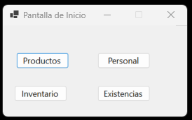
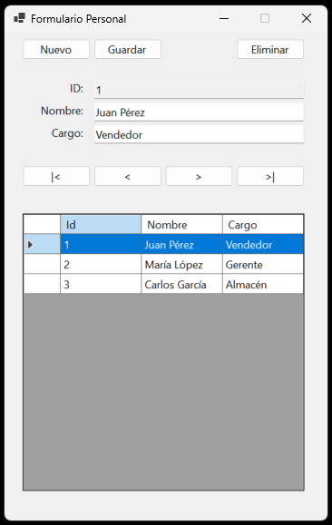
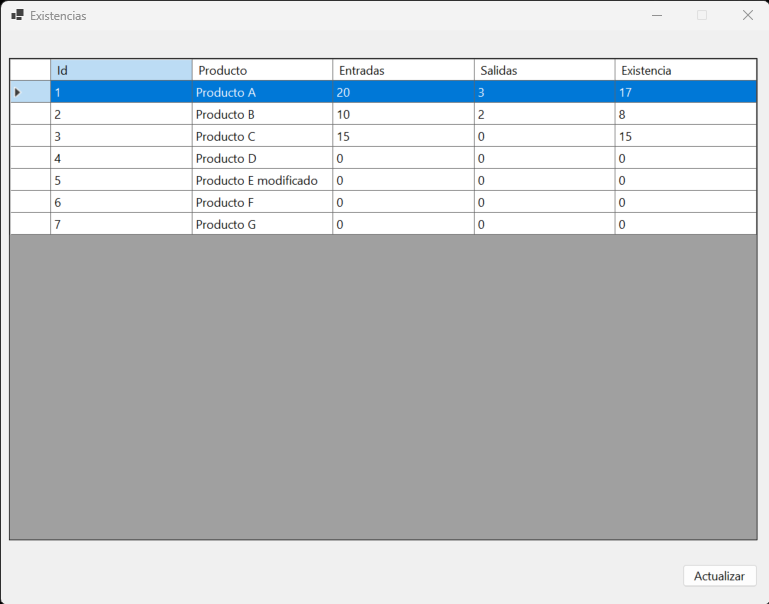
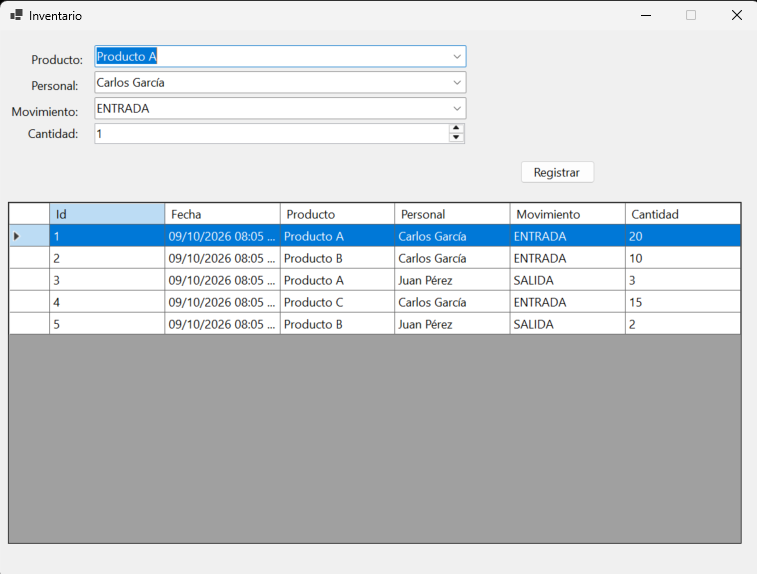
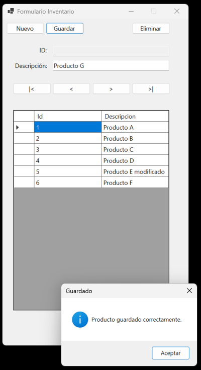
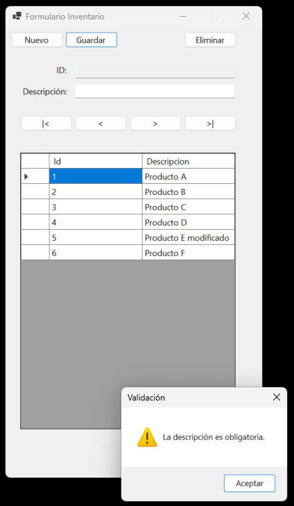
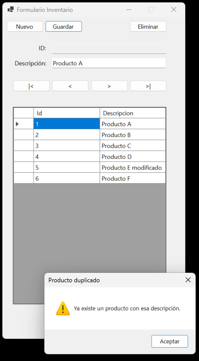

# VentaDeProductos 

Para esta práctica debemos:
* Generación de una interfaz gráfica con conexión a MySQL

Se utiliza la primer DB que realizamos dentro de clases referente a la actividad #1 "Generación Inicial de una Base de Datos", esta base de datos vive en localhost. La idea es poder demostrar la ralaciones entre las tablas que existe y el correcto funcionamiento de la interfaz grafica.

Para la conexión entre la interfaz grafica y MySQL se utilizó:
Visual Studio 2026 + C# + Windows Forms + Entity Framework Core + MySQL
Especificamente: MySql.EntityFrameworkCore 10.0.9 y Microsoft.EntityFrameworkCore.Tools
Despues con el comando Scaffold-DbContext se generaron las clases que se utilizarian en los diferentes formularios.

## Screenshots:

### Pantalla de inicio para poder navegar entre las tablas

### Pantalla del personal de nuestro negocio

### Pantalla de existencias

### Pantalla de todo nuestro inventario en almacén y movimientos

### Pantallas de como agregar inventario
Se incluyen algunas validaciones tales como "debe haber texto en la descripción, no debe ser duplicado, y por ultimo una confirmación cuando el campo es guardado con exito

